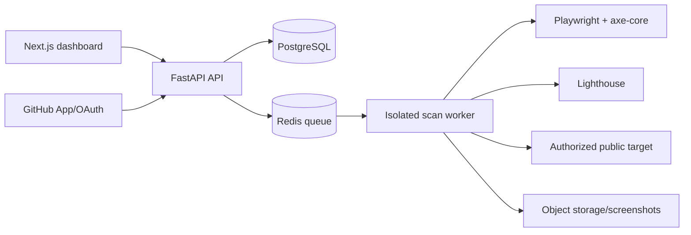

# AccessLens

AccessLens is a security-first web quality intelligence platform. It audits **authorized public websites** for accessibility, performance, SEO, and passive security posture.

## What is included

- FastAPI audit API with OpenAPI docs at `/docs`
- SSRF-resistant URL and redirect validation
- Playwright screenshots, axe-core accessibility checks, and optional Lighthouse metrics
- SEO, broken-link and HTTP security-header analysis
- PostgreSQL persistence, Redis-ready worker configuration, scheduled scan support
- Next.js dashboard, Docker Compose, Alembic migrations, tests, CI, and GitHub Action example

## Quick start

```bash
cp .env.example .env
docker compose up --build
```

Open `http://localhost:3000`. The API is at `http://localhost:8000`, with docs at `http://localhost:8000/docs`.

## Safety model

Projects own an allowlist of domains. Every initial URL, crawl candidate, redirect target, and resolved address is revalidated. Loopback, private, link-local, multicast, unspecified, and cloud metadata targets are refused. The scanner uses strict page/time limits and only performs passive GET/HEAD-style observations. It never attempts exploitation.

Set `DEMO_MODE=true` to use the seeded demo project. Add domains only that you control or are expressly authorized to test.

## Development

```bash
docker compose up db redis -d
cd backend && python -m venv .venv && .venv/Scripts/pip install -r requirements.txt
alembic upgrade head
uvicorn app.main:app --reload

cd ../frontend && npm install && npm run dev
```

```bash
cd backend && pytest
cd ../frontend && npm run lint
```

## Architecture



## Deployment

See [docs/deployment.md](docs/deployment.md). Production deployments must use managed Postgres/Redis, a separate browser-worker image with network egress controls, object storage for screenshots, and OAuth secrets from a secret manager.

## GitHub integration

The workflow in [examples/accesslens.yml](examples/accesslens.yml) submits a PR audit and supports a quality gate. GitHub OAuth/App installation and PR commenting need real GitHub credentials; this repository exposes a provider boundary but intentionally does not ship credentials.

## License

MIT
